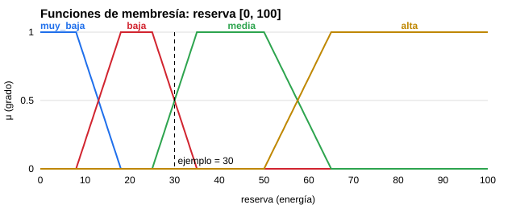
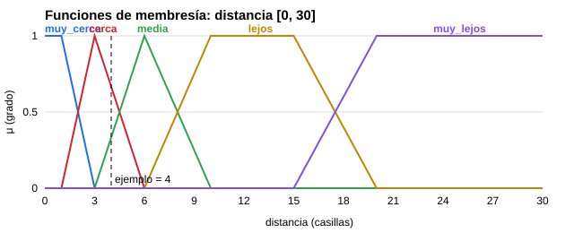
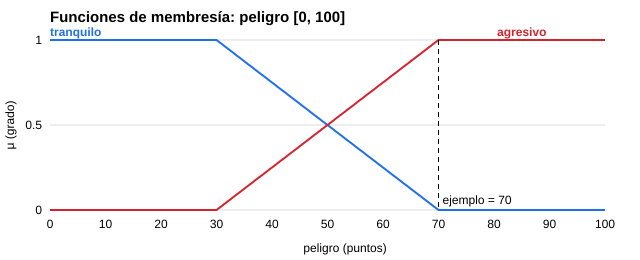
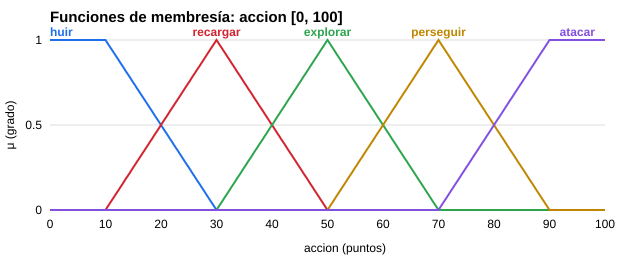
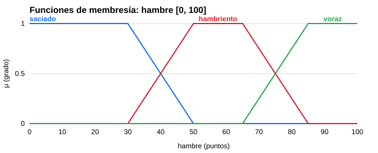
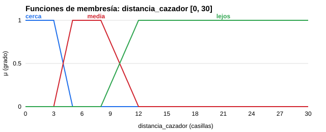
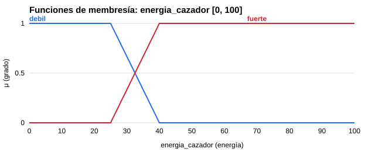
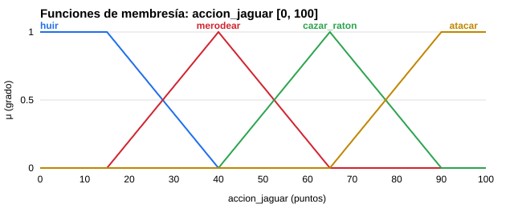
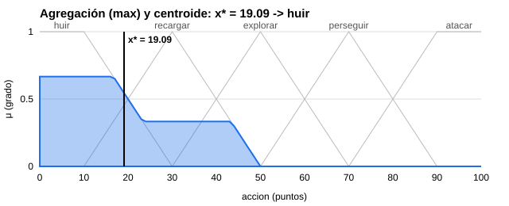

# Control difuso de los agentes (Método de Mamdani)

## 0. Supuestos y datos que faltaban

Al plantear el sistema nos faltaban algunos datos del proyecto, así que hicimos estos supuestos:

1. **DIOS no existía en el código, así que lo creamos** (`Logica_Difusa/dios.py`). Coordina a tres agentes:
   - **Agente 1 = cazador.** Usa control difuso con reglas entrenadas por el algoritmo genético.
   - **Agente 2 = jaguar.** También usa control difuso con reglas entrenadas por el algoritmo genético.
   - **Agente Tonto = ratones.** Siguen reglas fijas, no tienen memoria y no aprenden.
2. **El sistema difuso decide qué hace cada agente en cada turno.** El cazador elige entre huir, recargar, explorar, perseguir o atacar; el jaguar, entre huir, merodear, cazar ratón o atacar. Después, el algoritmo genético de movimiento (o A\*) decide cómo llega el cazador a su meta, y el jaguar usa A\*.
3. **Cada agente tiene tres entradas y una salida.** Se explican en la sección 2.
4. **El algoritmo genético solo aprende el consecuente de cada regla.** Los antecedentes (las condiciones) están fijos: 23 reglas para el cazador y 11 para el jaguar.
5. **Entrenamiento alternado.** Primero se entrenó al jaguar contra el cazador con las reglas del equipo, y después al cazador contra el jaguar ya entrenado.
6. **El entrenamiento usa un simulador sin ventana y por turnos:** primero el cazador, luego el jaguar y luego los ratones. En la ventana se mueven con física y a velocidades un poco distintas, así que el simulador es una aproximación del juego.

**Cosas que la lógica difusa no dice y tuvimos que decidir:**

- **Cómo pasar de x\* a una acción concreta.** El centroide da un número, no una palabra. Tomamos el término de salida con mayor grado en x\*.
- **Qué hacer si ninguna regla se activa (Σμ = 0).** El centroide se dividiría entre 0. En ese caso el cazador explora y el jaguar merodea. Casi no pasa, porque las reglas cubren todos los casos.
- **Qué tan fino discretizar la salida.** Usamos pasos de 1 (101 puntos). En la sección 5 se ve que con pasos de 10 el resultado cambia un poco.
- **El centroide promedia acciones opuestas.** Se explica en la sección 6.

## 1. Fases del sistema de control difuso

```
 Input  ->  Fuzzificación  ->  Inferencia (Control Rule Base)  ->  Defuzzificación  ->  Output
 números    grados 0 a 1       reglas IF-THEN                     centroide            acción
                               AND=min, OR=max, NOT=1-x            x* = Σx·μ / Σμ
                               implicación=min, AGG=max
```

En cada turno, cada agente difuso hace esto:

1. **Input.** Mide sus tres entradas.
2. **Fuzzificación.** Cada número se convierte en grados de membresía, de 0 a 1.
3. **Inferencia.** Se evalúa el antecedente de cada regla para obtener su fuerza. Con esa fuerza se recorta su conjunto de salida (implicación) y todos los recortes se juntan con max (agregación).
4. **Defuzzificación.** Del área que queda se calcula el centroide x\*.
5. **Output.** x\* se traduce a una acción y el agente la ejecuta.

Así queda la arquitectura:

```
                              DIOS (dios.py)
            ┌───────────────────┼────────────────────┐
     Agente 1: CAZADOR    Agente 2: JAGUAR     Agente Tonto: RATONES
     ControladorDifuso    ControladorDifuso    reglas fijas (sin memoria)
     base: cazador_*.json base: jaguar_*.json
            │ acción             │ acción
   AG de movimiento / A*        A*            <- cómo moverse

   entrenamiento_genetico.py --cromosoma--> BaseConocimiento --DIOS.actualizar_base--> agente
```

La **base de conocimiento** de cada agente es su memoria. Se guarda en `Logica_Difusa/bases/` y hay dos juegos para cada agente:

- `*_entrenadas.json`: las reglas que encontró el algoritmo genético.
- `*_equipo.json`: las reglas que escribimos nosotros, que también son la semilla del algoritmo.

## 2. Variables lingüísticas

**Agente 1: cazador**

| Variable | Tipo | Universo | Términos | Cómo se calcula |
|---|---|---|---|---|
| reserva | Entrada | 0 a 100 | muy_baja, baja, media, alta | Energía − energía necesaria para volver al campamento |
| distancia | Entrada | 0 a 30 casillas | muy_cerca, cerca, media, lejos, muy_lejos | Distancia al jaguar, o a donde lo vio por última vez. Vale 30 si no sabe nada de él |
| peligro | Entrada | 0 a 100 | tranquilo, agresivo | 100 si el jaguar lo ataca, el hambre del jaguar si lo percibe y 0 si no lo percibe |
| acción | Salida | 0 a 100 | huir, recargar, explorar, perseguir, atacar | Resultado del centroide |

**Agente 2: jaguar**

| Variable | Tipo | Universo | Términos | Cómo se calcula |
|---|---|---|---|---|
| hambre | Entrada | 0 a 100 | saciado, hambriento, voraz | Sube 2 por turno y baja al comer ratones o bayas |
| distancia_cazador | Entrada | 0 a 30 casillas | cerca, media, lejos | Distancia Manhattan al cazador |
| energia_cazador | Entrada | 0 a 100 | debil, fuerte | Energía del cazador. Si está débil, el jaguar se anima a atacar |
| accion_jaguar | Salida | 0 a 100 | huir, merodear, cazar_raton, atacar | Resultado del centroide |

## 3. Funciones de membresía

| Variable | Término | Tipo | X0 | X1 | X2 | X3 |
|---|---|---|---|---|---|---|
| reserva | muy_baja | grado inversa | 8 | 18 | – | – |
| reserva | baja | trapezoidal | 8 | 18 | 25 | 35 |
| reserva | media | trapezoidal | 25 | 35 | 50 | 65 |
| reserva | alta | grado | 50 | 65 | – | – |
| distancia | muy_cerca | grado inversa | 1 | 3 | – | – |
| distancia | cerca | triangular | 1 | 3 | 6 | – |
| distancia | media | triangular | 3 | 6 | 10 | – |
| distancia | lejos | trapezoidal | 6 | 10 | 15 | 20 |
| distancia | muy_lejos | grado | 15 | 20 | – | – |
| peligro | tranquilo | grado inversa | 40 | 80 | – | – |
| peligro | agresivo | grado | 40 | 80 | – | – |
| acción | huir | grado inversa | 10 | 30 | – | – |
| acción | recargar | triangular | 10 | 30 | 50 | – |
| acción | explorar | triangular | 30 | 50 | 70 | – |
| acción | perseguir | triangular | 50 | 70 | 90 | – |
| acción | atacar | grado | 70 | 90 | – | – |
| hambre | saciado | grado inversa | 30 | 50 | – | – |
| hambre | hambriento | trapezoidal | 30 | 50 | 65 | 85 |
| hambre | voraz | grado | 65 | 85 | – | – |
| distancia_cazador | cerca | grado inversa | 3 | 5 | – | – |
| distancia_cazador | media | trapezoidal | 3 | 5 | 8 | 12 |
| distancia_cazador | lejos | grado | 8 | 12 | – | – |
| energia_cazador | debil | grado inversa | 25 | 40 | – | – |
| energia_cazador | fuerte | grado | 25 | 40 | – | – |
| accion_jaguar | huir | grado inversa | 15 | 40 | – | – |
| accion_jaguar | merodear | triangular | 15 | 40 | 65 | – |
| accion_jaguar | cazar_raton | triangular | 40 | 65 | 90 | – |
| accion_jaguar | atacar | grado | 65 | 90 | – | – |

**Fórmulas** (μ siempre queda entre 0 y 1):

- **Grado:** μ = 0 si x ≤ X0; μ = (x − X0)/(X1 − X0) si X0 < x < X1; μ = 1 si x ≥ X1.
- **Grado inversa:** μ = 1 si x ≤ X0; μ = (X1 − x)/(X1 − X0) si X0 < x < X1; μ = 0 si x ≥ X1.
- **Triangular:** μ = (x − X0)/(X1 − X0) al subir; μ = (X2 − x)/(X2 − X1) al bajar; 0 fuera de [X0, X2].
- **Trapezoidal:** μ sube de X0 a X1, vale 1 entre X1 y X2, baja de X2 a X3, y es 0 fuera de [X0, X3].

**Traslape.** Dos términos vecinos se cruzan siempre en μ = 0.5, y en cualquier punto los grados suman 1. Así ningún valor se queda sin término y el paso de uno a otro es gradual. Algunos límites salen del juego:

- El jaguar detecta al cazador a 4 casillas. Por eso "cerca" para el jaguar baja de 3 a 5.
- El jaguar ataca cuando el cazador tiene menos de 30 de energía. Por eso "débil" baja de 25 a 40.

En las gráficas del cazador, la línea punteada marca el valor del ejemplo de la sección 5.










## 4. Base de conocimiento (reglas)

Las reglas son del tipo **SI antecedente ENTONCES consecuente** y ninguna lleva ELSE. Si la condición no se cumple, la regla pesa 0 y no aporta nada. Usan los tres operadores: **Y** (AND = min), **O** (OR = max) y **NO** (NOT = 1 − x).

### 4.1 Cazador (23 reglas)

**R01–R20** forman una matriz de reserva × distancia y se aplican cuando el jaguar NO está agresivo:

> SI reserva ES *fila* Y distancia ES *columna* Y NO (peligro ES agresivo) ENTONCES acción ES *celda*

Reglas del equipo:

| reserva \ distancia | muy_cerca | cerca | media | lejos | muy_lejos |
|---|---|---|---|---|---|
| **muy_baja** | R01 recargar | R02 recargar | R03 recargar | R04 recargar | R05 recargar |
| **baja** | R06 atacar | R07 perseguir | R08 recargar | R09 recargar | R10 recargar |
| **media** | R11 atacar | R12 perseguir | R13 perseguir | R14 explorar | R15 explorar |
| **alta** | R16 atacar | R17 atacar | R18 perseguir | R19 perseguir | R20 explorar |

**R21–R23** se aplican cuando el jaguar está agresivo:

| Regla | Antecedente | Equipo |
|---|---|---|
| R21 | peligro ES agresivo Y (distancia ES muy_cerca O distancia ES cerca) | huir |
| R22 | peligro ES agresivo Y distancia ES media | recargar |
| R23 | peligro ES agresivo Y (distancia ES lejos O distancia ES muy_lejos) | explorar |

### 4.2 Jaguar (11 reglas)

**R01–R09** forman una matriz de hambre × distancia_cazador y se aplican cuando el cazador NO está débil:

> SI hambre ES *fila* Y distancia_cazador ES *columna* Y NO (energia_cazador ES debil) ENTONCES accion_jaguar ES *celda*

Reglas del equipo, que imitan cómo se comportaba el jaguar antes de la lógica difusa:

| hambre \ distancia_cazador | cerca | media | lejos |
|---|---|---|---|
| **saciado** | R01 huir | R02 merodear | R03 merodear |
| **hambriento** | R04 huir | R05 cazar_raton | R06 cazar_raton |
| **voraz** | R07 atacar | R08 atacar | R09 cazar_raton |

**R10–R11** se aplican cuando el cazador está débil:

| Regla | Antecedente | Equipo |
|---|---|---|
| R10 | energia_cazador ES debil Y (distancia_cazador ES cerca O distancia_cazador ES media) | atacar |
| R11 | energia_cazador ES debil Y distancia_cazador ES lejos | merodear |

Las reglas que encontró el algoritmo genético para los dos agentes están en la sección 7.

## 5. Ejemplo numérico completo (cazador)

**Situación:** reserva = **30**, distancia = **4** casillas y peligro = **70**. El cazador tiene media energía, el jaguar está a 4 casillas y bastante hambriento. Usamos las reglas del equipo.

### 5.1 Fuzzificación

| Entrada | Término | Cálculo | μ |
|---|---|---|---|
| reserva = 30 | muy_baja | 30 ≥ 18 | 0 |
| | baja | baja de 25 a 35: (35 − 30)/(35 − 25) | **0.5** |
| | media | sube de 25 a 35: (30 − 25)/(35 − 25) | **0.5** |
| | alta | 30 ≤ 50 | 0 |
| distancia = 4 | muy_cerca | 4 ≥ 3 | 0 |
| | cerca | baja de 3 a 6: (6 − 4)/(6 − 3) | **0.667** |
| | media | sube de 3 a 6: (4 − 3)/(6 − 3) | **0.333** |
| | lejos, muy_lejos | fuera de rango | 0 |
| peligro = 70 | tranquilo | (80 − 70)/(80 − 40) | **0.25** |
| | agresivo | (70 − 40)/(80 − 40) | **0.75** |

NOT (peligro ES agresivo) = 1 − 0.75 = **0.25**

### 5.2 Evaluación del antecedente de cada regla

Solo se muestran las reglas con fuerza mayor que 0. Las demás valen 0 porque alguno de sus términos vale 0; por ejemplo, R06 = min(0.5, 0, 0.25) = 0.

| Regla | Antecedente | Cálculo | Fuerza | Consecuente |
|---|---|---|---|---|
| R07 | baja Y cerca Y NO agresivo | min(0.5, 0.667, 0.25) | 0.25 | perseguir |
| R08 | baja Y media Y NO agresivo | min(0.5, 0.333, 0.25) | 0.25 | recargar |
| R12 | media Y cerca Y NO agresivo | min(0.5, 0.667, 0.25) | 0.25 | perseguir |
| R13 | media Y media Y NO agresivo | min(0.5, 0.333, 0.25) | 0.25 | perseguir |
| R21 | agresivo Y (muy_cerca O cerca) | min(0.75, max(0, 0.667)) | **0.667** | huir |
| R22 | agresivo Y media | min(0.75, 0.333) | 0.333 | recargar |
| R23 | agresivo Y (lejos O muy_lejos) | min(0.75, max(0, 0)) | 0 | explorar |

### 5.3 Implicación (recorte con min)

Cada conjunto de salida se recorta a la altura de la fuerza de su regla: μ'(x) = min(fuerza, μ(x)). Si varias reglas llevan al mismo término, queda la altura mayor, porque después se agrega con max:

| Conjunto de salida | Reglas | Altura del recorte |
|---|---|---|
| huir | R21 | **0.667** |
| recargar | R08, R22 | max(0.25, 0.333) = **0.333** |
| perseguir | R07, R12, R13 | max(0.25, 0.25, 0.25) = **0.25** |
| explorar, atacar | ninguna | 0 |

### 5.4 Agregación (max)

μ_agg(x) = max( min(0.667, μ_huir(x)), min(0.333, μ_recargar(x)), min(0.25, μ_perseguir(x)) )

Queda una figura con tres "mesetas": una alta en *huir* (0.667), otra más baja en *recargar* (0.333) y otra pequeña en *perseguir* (0.25).



### 5.5 Centroide

**Fórmula:** x\* = Σ x·μ_agg(x) / Σ μ_agg(x)

Para poder sumar, el universo de salida (0 a 100) se **discretiza**: se toman puntos separados por un paso fijo. A mano usamos un paso de 10 (11 puntos):

| x | huir recortado | recargar recortado | perseguir recortado | μ_agg (max) | x·μ_agg |
|---|---|---|---|---|---|
| 0 | min(0.667, 1) = 0.667 | 0 | 0 | 0.667 | 0 |
| 10 | min(0.667, 1) = 0.667 | 0 | 0 | 0.667 | 6.67 |
| 20 | min(0.667, 0.5) = 0.5 | min(0.333, 0.5) = 0.333 | 0 | 0.5 | 10.00 |
| 30 | 0 | min(0.333, 1) = 0.333 | 0 | 0.333 | 10.00 |
| 40 | 0 | min(0.333, 0.5) = 0.333 | 0 | 0.333 | 13.33 |
| 50 | 0 | 0 | 0 | 0 | 0 |
| 60 | 0 | 0 | min(0.25, 0.5) = 0.25 | 0.25 | 15.00 |
| 70 | 0 | 0 | min(0.25, 1) = 0.25 | 0.25 | 17.50 |
| 80 | 0 | 0 | min(0.25, 0.5) = 0.25 | 0.25 | 20.00 |
| 90 | 0 | 0 | 0 | 0 | 0 |
| 100 | 0 | 0 | 0 | 0 | 0 |
| **Suma** | | | | **3.25** | **92.50** |

**x\* = 92.50 / 3.25 = 28.46**

En x\* = 28.46, μ_recargar = 0.92 y μ_huir = 0.08, así que la acción es **recargar**.

**El programa usa un paso de 1** (101 puntos). Ahí Σμ = 31.30 y Σx·μ = 1043.05, así que **x\* = 33.32**. En ese punto μ_recargar = 0.83 y μ_explorar = 0.17, y la acción sigue siendo **recargar**. Con más puntos, la suma se parece más al área real de la figura y el resultado es más exacto.

**Conclusión:** la regla más fuerte dice *huir* y otras dicen *perseguir*, y el resultado combinado es **recargar**: alejarse hacia el campamento o hacia una baya buena.

### 5.6 Ejemplo corto del jaguar

**Situación:** hambre = 70, distancia_cazador = 4 y energia_cazador = 35. Usamos las reglas del equipo.

- **Fuzzificación:**
  - hambre: hambriento 0.75, voraz 0.25
  - distancia: cerca 0.5, media 0.5
  - energía: débil 0.333, fuerte 0.667

  NO débil = 1 − 0.333 = 0.667
- **Reglas activas:**
  - R04 huir = min(0.75, 0.5, 0.667) = 0.5
  - R05 cazar_raton = min(0.75, 0.5, 0.667) = 0.5
  - R07 y R08 atacar = min(0.25, 0.5, 0.667) = 0.25
  - R10 atacar = min(0.333, max(0.5, 0.5)) = 0.333
- **Implicación:** huir 0.5, cazar_raton 0.5 y atacar max(0.25, 0.25, 0.333) = 0.333.
- **Centroide:** x\* = 48.11. En ese punto μ_merodear = 0.68 y μ_cazar_raton = 0.32, así que el jaguar **merodea**.

## 6. El centroide

**Qué representa.** El centroide es el **centro de masa** del área agregada: el punto donde la figura quedaría en equilibrio si fuera una lámina recortada. Cada x "pesa" según su altura μ_agg(x).

**Por qué lo usamos:**

- Toma en cuenta **todas** las reglas activas, cada una según su fuerza, no solo la más fuerte.
- La salida cambia de forma **suave**: si una entrada cambia poco, x\* también cambia poco, y el agente no salta de golpe entre acciones.
- Es el método que pide la práctica y el más común con Mamdani.

**Cómo cambia la salida cuando cambian las reglas activadas.** Si dejamos fijas la reserva del cazador (30) y la distancia (4) y solo subimos el peligro, se activan otras reglas y el centroide se mueve:

| peligro | Reglas con más fuerza | x\* | Acción |
|---|---|---|---|
| 0 a 40 | R07 y R12 (perseguir 0.5), R08 (recargar 0.333) | 52.99 | explorar |
| 50 | aparecen R21 (huir) y R22 (recargar) | 47.79 | explorar |
| 60 | R21 huir 0.5 contra perseguir 0.5 | 42.21 | explorar |
| 70 | R21 huir 0.667 gana peso | 33.32 | recargar |
| 80 a 100 | solo R21 (huir 0.667) y R22 (recargar 0.333) | 19.09 | huir |

Mientras más fuerza tienen las reglas defensivas, más se jala el centro de masa hacia la izquierda: de explorar a recargar y después a huir. Si cambiamos el consecuente de una regla (por ejemplo, R21 de *huir* a *perseguir*), su área se mueve al otro lado del eje y x\* se recorre hacia la derecha.

**Limitación que encontramos.** El centroide **promedia**. Con peligro = 60, *huir* y *perseguir* tienen la misma fuerza (0.5), y el centro de masa cae en medio, en *explorar*, aunque ninguna regla dijo "explorar". En el ejemplo del jaguar pasa lo mismo: *huir* y *cazar_raton* empatan y sale *merodear*. En un control continuo, como la velocidad de un ventilador, promediar está bien. En decisiones que se excluyen entre sí, a veces da una acción intermedia. Lo dejamos así porque la práctica pide el centroide; además, el algoritmo genético entrena las reglas sabiendo que se usa este método, así que aprende a evitar las combinaciones que le hacen perder.

## 7. Entrenamiento genético de las reglas

### 7.1 Cómo funciona

El algoritmo genético es el que **genera la base de conocimiento** de cada agente:

- **Cromosoma:** un gen por regla. El cazador tiene 23 genes y el jaguar 11. Cada gen es el consecuente de su regla, guardado como número:
  - Cazador: 0 = huir, 1 = recargar, 2 = explorar, 3 = perseguir, 4 = atacar.
  - Jaguar: 0 = huir, 1 = merodear, 2 = cazar_raton, 3 = atacar.
- **Población inicial:** 16 cromosomas. Uno son las reglas del equipo, siete son variaciones de ellas y ocho son al azar.
- **Aptitud:** cada cromosoma se convierte en reglas y juega 30 partidas sin ventana (mapas con semillas 0 a 29) contra las reglas actuales del otro agente. Su aptitud es el promedio de puntos:

| Cazador | Jaguar |
|---|---|
| Cazar al jaguar: +100, más hasta +50 si lo hace rápido, más +20 si regresa a la cabaña | Cazar al cazador: +100 |
| Morir (atacado o sin energía): −100 | Sobrevivir hasta el final: +50 |
| Se acaba el tiempo: −10 | Ser cazado: −100 (menos castigo entre más aguante) |
| Esconderse en la cabaña con energía llena antes de cazar: −0.5 por turno | Cada ratón comido: +5 |

**Por qué está el castigo por esconderse.** En el primer entrenamiento, el algoritmo genético encontró una "trampa": al cazador le convenía quedarse en la cabaña y esperar a que el jaguar llegara. Así casi no moría, y que se acabara el tiempo solo restaba 10 puntos. En el juego se veía mal, porque al iniciar el cazador no salía de la cabaña. Pasaba en promedio 152 de 400 turnos escondido. Con el castigo de −0.5 por cada turno que se queda en la cabaña sin nada que recargar, el algoritmo aprendió a salir a cazar: ahora pasa en promedio 0.2 turnos escondido. Esto pasa seguido con los algoritmos genéticos: **optimizan exactamente lo que dice la aptitud**, así que si la aptitud tiene un hueco, lo aprovechan.

- **Operadores:** los mismos del algoritmo genético de movimiento:
  - elitismo: los 2 mejores pasan directo;
  - selección por torneo de 3;
  - cruce de un punto, 70 % de las veces;
  - mutación del 8 % por gen, que siempre cambia a otra acción.
- **Generaciones:** 12. Al final, el mejor cromosoma se guarda como `bases/<agente>_entrenadas.json`.
- **Orden:** primero se entrenó al jaguar contra el cazador del equipo, y luego al cazador contra el jaguar ya entrenado.

### 7.2 Evolución de la aptitud

| Generación | Jaguar: mejor | Jaguar: promedio | Cazador: mejor | Cazador: promedio |
|---|---|---|---|---|
| 1 | 65.22 | −19.30 | −38.03 | −87.03 |
| 2 | 91.47 | 40.17 | −38.03 | −63.44 |
| 4 | 100.34 | 85.50 | −20.87 | −43.13 |
| 6 | 100.34 | 96.16 | −12.19 | −31.25 |
| 8 | 101.00 | 89.55 | −12.19 | −30.29 |
| 10 | 101.17 | 88.23 | −12.19 | −20.13 |
| 12 | 101.17 | 95.31 | −12.19 | −26.23 |

Con las reglas del equipo, el jaguar sacaba **9.00** y llegó a **101.17**. El cazador, contra ese jaguar ya entrenado, sacaba **−91.00** con las reglas del equipo (moría casi siempre) y llegó a **−12.19**. El promedio sube y baja porque la mutación siempre mete cromosomas nuevos, algunos malos. El mejor nunca baja, gracias al elitismo.

### 7.3 Reglas que encontró el algoritmo genético

**Jaguar (Agente 2):**

| hambre \ distancia_cazador | cerca | media | lejos |
|---|---|---|---|
| **saciado** | atacar | merodear | cazar_raton |
| **hambriento** | merodear | cazar_raton | merodear |
| **voraz** | atacar | atacar | huir |

- R10: cazador débil Y (cerca O media) → **atacar**
- R11: cazador débil Y lejos → **atacar**

El jaguar entrenado aprendió a ser **agresivo**: si el cazador está débil, lo ataca aunque esté lejos, y si lo tiene cerca, lo ataca aunque no tenga hambre. Las reglas del equipo lo hacían huir.

**Cazador (Agente 1):**

| reserva \ distancia | muy_cerca | cerca | media | lejos | muy_lejos |
|---|---|---|---|---|---|
| **muy_baja** | explorar | huir | recargar | recargar | huir |
| **baja** | atacar | perseguir | perseguir | huir | explorar |
| **media** | atacar | atacar | explorar | atacar | explorar |
| **alta** | atacar | explorar | atacar | recargar | huir |

- R21: jaguar agresivo Y (muy_cerca O cerca) → **explorar**
- R22: jaguar agresivo Y media → **huir**
- R23: jaguar agresivo Y (lejos O muy_lejos) → **perseguir**

El cazador entrenado aprendió a **atacar cuando el jaguar está muy cerca**, casi sin importar su energía, y a perseguirlo cuando tiene reserva baja y lo tiene a media distancia.

Algunas reglas se ven raras para una persona, como "si tiene reserva alta y el jaguar está muy lejos, huir". Hay dos razones:

- **Algunas casi nunca se usan o no cambian nada.** Cuando el cazador no sabe dónde está el jaguar, *huir* no tiene de qué huir, así que el agente lo cambia por *explorar*; el panel lo muestra así. Lo mismo pasa con *atacar* y *perseguir*: sin saber dónde está el jaguar, no tienen a dónde ir.
- **El centroide combina varias reglas a la vez.** El algoritmo eligió consecuentes que, ya promediados, dan buen resultado, aunque una regla sola no se lea lógica.

Esto es normal en reglas aprendidas: el algoritmo optimiza el resultado, no que se entiendan.

### 7.4 Resultados en 60 mapas nuevos

Probamos cada combinación en 60 mapas que el algoritmo genético **nunca vio** (semillas 1000 a 1059), con `python3 -m Logica_Difusa.comparar 60`:

| Cazador | Jaguar | Jaguar cazado | Cazador muerto | Se acabó el tiempo | Aptitud cazador | Aptitud jaguar |
|---|---|---|---|---|---|---|
| **entrenadas** | **entrenadas** | 20 % | 80 % | 0 % | **−46.8** | 66.6 |
| equipo | entrenadas | 17 % | 83 % | 0 % | −55.6 | **72.4** |
| aleatorio | entrenadas | 20 % | 68 % | 12 % | −42.3 | 64.3 |
| **entrenadas** | equipo | 50 % | 50 % | 0 % | **28.8** | 8.0 |
| equipo | equipo | 40 % | 60 % | 0 % | 5.1 | 29.3 |
| aleatorio | equipo | 22 % | 70 % | 8 % | −44.3 | 65.2 |
| **entrenadas** | aleatorio | 93 % | 5 % | 2 % | 150.4 | −78.0 |
| equipo | aleatorio | 97 % | 2 % | 2 % | **158.6** | −83.4 |
| aleatorio | aleatorio | 45 % | 12 % | 43 % | 25.8 | −9.7 |

La aptitud del cazador ya incluye el castigo por esconderse.

**Qué se ve:**

1. **El jaguar entrenado es mucho mejor que el del equipo.** Contra el cazador del equipo, su aptitud sube de 29.3 a 72.4, y el cazador muere en el 83 % de los mapas en lugar del 60 %.
2. **El cazador entrenado mejora a las reglas del equipo.** Contra el jaguar del equipo, caza en el 50 % de los mapas (el del equipo, 40 %) y su aptitud sube de 5.1 a 28.8. Contra el jaguar al azar caza en el 93 % de los mapas, casi igual que el del equipo (97 %). Contra el jaguar entrenado le va un poco mejor que al del equipo (−46.8 contra −55.6), pero todos los cazadores pierden: ese jaguar es muy agresivo. Ahí, el cazador al azar saca −42.3, casi lo mismo, porque se le acaba el tiempo en el 12 % de los mapas en lugar de morir.
3. **Las reglas al azar pierden contra las entrenadas.** Contra el jaguar entrenado, el cazador al azar solo saca −36.5. El jaguar al azar es el peor: el cazador del equipo lo caza en el 97 % de los mapas. Esto confirma que **el motor difuso decide tan bien como su base de conocimiento**.
4. **Limitación: el jaguar entrenado sigue ganando.** Contra él, ningún cazador muere menos del 68 % de las veces. Para mejorar al cazador, habría que entrenarlo más generaciones o alternar varias rondas de entrenamiento entre los dos agentes.

## 8. Código

El código está en la carpeta `Logica_Difusa/`, sin librerías de lógica difusa:

| Parte | Archivo | Qué hace |
|---|---|---|
| Funciones de membresía | `funciones_membresia.py` | `grado`, `grado_inversa`, `triangular`, `trapezoidal`, y las clases `Termino` y `VariableLinguistica` |
| Operadores | `operadores.py` | `AND` = min, `OR` = max, `NOT` = 1 − x, `implicacion` = min, `AGG` = max |
| Variables | `variables.py` | Universos y puntos X0..X3 del cazador y del jaguar |
| Motor Mamdani | `motor_mamdani.py` | `fuzzificar`, `evaluar` (antecedentes), implicación, agregación y `ControladorDifuso.decidir` |
| Centroide | `motor_mamdani.py` | `universo_salida` (discretiza) y `centroide` (Σx·μ / Σμ) |
| Base de conocimiento | `base_conocimiento.py` | `Perfil` (forma de las reglas de cada agente), `BaseConocimiento` con `guardar`/`cargar` en JSON, `a_cromosoma`/`desde_cromosoma` y `reemplazar_consecuente` |
| Orquestador | `dios.py` | `consultar`, `controlador`, `actualizar_base`, `ajustar_regla`, `cambiar_modo`, `decision_tonto`, `comparar` |
| Algoritmo genético | `entrenamiento_genetico.py` | Crea y mejora las reglas de cada agente |
| Simulador | `simulador.py` | Partidas sin ventana y la aptitud de cada agente |
| Comparación | `comparar.py` | Juega reglas entrenadas, del equipo y al azar en mapas nuevos |
| Gráficas | `graficas.py` | Genera las imágenes de este reporte |

**Funciones de membresía:**

```python
def triangular(x, x0, x1, x2):
    if x <= x0 or x >= x2:
        return 0.0
    if x <= x1:
        return (x - x0) / (x1 - x0)
    return (x2 - x) / (x2 - x1)
```

**Operadores de Mamdani:**

```python
def AND(*valores):  return min(valores)
def OR(*valores):   return max(valores)
def NOT(valor):     return 1.0 - valor
def implicacion(fuerza_regla, grado_salida):  return min(fuerza_regla, grado_salida)
def AGG(*valores):  return max(valores) if valores else 0.0
```

**Una regla en la base de conocimiento (JSON).** Es la R21 del cazador; no lleva ELSE:

```json
{"id": "R21",
 "si": {"y": [ {"var": "peligro", "es": "agresivo"},
               {"o": [ {"var": "distancia", "es": "muy_cerca"},
                       {"var": "distancia", "es": "cerca"} ]} ]},
 "entonces": ["accion", "huir"]}
```

**Evaluación del antecedente** (recursiva):

```python
def evaluar(nodo, grados):
    if "var" in nodo: return grados[nodo["var"]][nodo["es"]]
    if "no" in nodo:  return NOT(evaluar(nodo["no"], grados))
    if "y" in nodo:   return AND(*(evaluar(h, grados) for h in nodo["y"]))
    if "o" in nodo:   return OR(*(evaluar(h, grados) for h in nodo["o"]))
```

**Centroide:**

```python
def centroide(xs, mus):
    suma_mu = sum(mus)
    if suma_mu == 0:
        return None          # ninguna regla se activó
    return sum(x * mu for x, mu in zip(xs, mus)) / suma_mu
```

**Puntos de conexión:**

```python
dios = obtener_dios()

# El AG convierte un cromosoma en reglas y DIOS se las da al agente
base = BaseConocimiento.desde_cromosoma("jaguar", cromosoma)
dios.actualizar_base("Agente 2", base)            # también la guarda en JSON
dios.ajustar_regla("Agente 1", "R21", "huir")     # cambiar una sola regla

# El orquestador pregunta qué haría cada agente
dios.consultar("Agente 1", {"reserva": 30, "distancia": 4, "peligro": 70})
dios.consultar("Agente 2", {"hambre": 70, "distancia_cazador": 4, "energia_cazador": 35})
```

**Qué hace cada agente con la acción difusa:**

| Cazador (`Agente_Cazador/agente.py`) | Qué hace |
|---|---|
| huir | Se aleja del jaguar con `Huida.elegir_escape` |
| recargar | Va al campamento o a una baya buena que recuerde, por el camino más seguro (A\*) |
| explorar | Busca zonas no revisadas o investiga bayas desconocidas |
| perseguir | Le corta el paso al jaguar, o lo sigue por el oído, el olfato o la memoria |
| atacar | Va directo a donde está el jaguar |

| Jaguar (`Agente_Jaguar/agente.py`) | Qué hace |
|---|---|
| huir | Escape inteligente; si está acorralado y el cazador está a 2 casillas o menos, contraataca |
| merodear | Descansa o camina sin rumbo |
| cazar_raton | Va hacia el ratón más cercano que huela, o lo busca |
| atacar | Intercepta al cazador |

**Comandos:**

```
python3 -m Logica_Difusa.entrenamiento_genetico jaguar    # entrena al jaguar
python3 -m Logica_Difusa.entrenamiento_genetico cazador   # entrena al cazador
python3 -m Logica_Difusa.comparar 60                      # compara en 60 mapas nuevos
python3 -m Logica_Difusa.graficas                         # vuelve a crear las gráficas
python3 main.py                                           # juego (tecla D: reglas entrenadas / del equipo)
```

## 9. Agente Tonto (ratones) contra agentes entrenados

| | Agente Tonto (ratones) | Agentes 1 y 2 (cazador y jaguar) |
|---|---|---|
| ¿Cómo decide? | Con reglas fijas de tipo si / si no, escritas en el código | Con lógica difusa: varias reglas a la vez, cada una con su fuerza |
| ¿Tiene memoria o base de conocimiento? | No. Solo ve lo que pasa en el momento | Sí: su base de conocimiento en JSON, y el cazador además recuerda el mapa y las bayas |
| ¿Aprende? | No, siempre hace lo mismo | Sus reglas las mejora el algoritmo genético jugando muchas partidas |
| ¿Cuántos datos usa? | Uno: si el jaguar está a 3 casillas o menos | Tres entradas difusas |
| ¿Cómo cambia su decisión? | De golpe: a 3.0 casillas huye y a 3.1 sigue caminando | Poco a poco, gracias al traslape de los términos |

Reglas fijas de los ratones:

1. Si el jaguar está a 3 casillas o menos, huir en línea recta por el eje que más los separa.
2. Si no ve al jaguar, caminar en una dirección al azar y cambiarla cada 0.8 a 2 segundos.
3. Si choca con un árbol o un borde, elegir otra dirección libre, sin regresarse si puede.

Como los ratones no razonan ni aprenden, sirven para comparar: el jaguar entrenado aprende a usarlos como comida.

**¿El algoritmo genético de verdad ayuda?** Además de los ratones, probamos a cada agente con reglas al azar (`base_aleatoria`). Esas reglas usan el mismo motor difuso, pero con una mala base de conocimiento. Los resultados de la sección 7 muestran que **un agente difuso decide tan bien como sus reglas**.

## 10. Observaciones

- **Reglas sin ELSE.** Cumplen el requisito: cuando una condición no se cumple, la regla pesa 0. Para que siempre haya alguna regla activa, las condiciones cubren todo el espacio: la matriz cubre el caso con "NO excepción" y las reglas extra cubren el caso con excepción.
- **Implicación por término.** En el código, si varias reglas tienen el mismo consecuente, recortamos el conjunto una sola vez con la fuerza mayor. Da exactamente lo mismo que recortar regla por regla y luego agregar con max, pero hace menos cálculos.
- **Rangos.** Todos los grados quedan entre 0 y 1, porque `Termino.grado` los limita. Si una entrada sale de su universo (por ejemplo, una distancia de 35), se ajusta al borde (30).
- **Reflejos fuera del sistema difuso:**
  - El cazador ataca al jaguar si está en la casilla de al lado, pero solo cuando su decisión difusa es perseguir o atacar.
  - Al cazar al jaguar, el cazador siempre regresa a la cabaña.
  - Después de atacar, el jaguar se retira unos turnos sin consultar sus reglas.

## 11. Relación con el material de clase (U4 Lógica Difusa)

Cada punto del documento de la unidad 4 está en el proyecto así:

| Material de clase | Dónde está en el proyecto |
|---|---|
| Membresía entre 0 y 1 (0 = no pertenece, 1 = pertenece totalmente) | `Termino.grado` siempre regresa un valor entre 0 y 1 |
| Universo de discurso X | `VariableLinguistica(minimo, maximo)`, por ejemplo distancia de 0 a 30 casillas |
| Función de grado (X0, X1) y de grado inversa | `grado` y `grado_inversa`, por ejemplo "alta" y "muy_baja" de la reserva |
| Función de triángulo (X0, X1, X2) | `triangular`, por ejemplo "cerca" y "media" de la distancia |
| Función trapezoidal (X0, X1, X2, X3) | `trapezoidal`, por ejemplo "baja" y "media" de la reserva |
| Grupos difusos: varias funciones con la misma variable x | Cada `VariableLinguistica` agrupa sus términos; por ejemplo, la distancia tiene muy_cerca, cerca, media, lejos y muy_lejos |
| Fase 1: Fuzzificación | `fuzzificar()` en `motor_mamdani.py` (sección 5.1) |
| Fase 2: Reglas con antecedente y consecuente (If-then) | `base_conocimiento.py`. Cada regla tiene "si" (antecedente) y "entonces" (consecuente) |
| AND = menor, OR = mayor, NOT = 1 − valor | `AND`, `OR` y `NOT` en `operadores.py` |
| Matriz de la base de conocimiento (temperatura actual contra deseada) | Matriz reserva × distancia del cazador y hambre × distancia del jaguar (sección 4) |
| Método de Mamdani: evaluar antecedentes, conclusión de cada regla, agregar conclusiones y defuzzificar | `ControladorDifuso.decidir()` sigue esos 4 pasos (secciones 5.2 a 5.5) |
| Defuzzificación por centroide, con método geométrico o numérico | Usamos el método numérico: Σ x·μ(x) / Σ μ(x) con pasos de 1 (sección 6) |
| Algoritmo: definir variables, funciones de membresía y base de reglas, y luego fuzzificar, inferir y defuzzificar | `variables.py` → `base_conocimiento.py` → `motor_mamdani.py` |

**Comprobación con el ejemplo de clase.** El ejemplo del adulto usa la función de grado con X0 = 18 y X1 = 21. Nuestra función `grado` da los mismos valores: 12 años → 0.0, 19 años → 0.333 y 35 años → 1.0. El ejemplo del manejo usa AND(0.8, 0.6); nuestra función `AND` da 0.6, igual que en clase.

**Sobre el ELSE.** El material de clase menciona reglas IF-THEN-ELSE en el ejemplo del aire acondicionado. En este proyecto las reglas no llevan ELSE, como se pidió en los requisitos. El caso contrario lo cubre otra regla con NOT, por ejemplo "SI ... Y NO peligro agresivo" contra "SI peligro agresivo ...".
