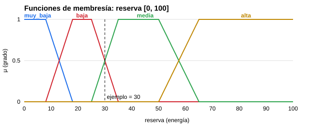
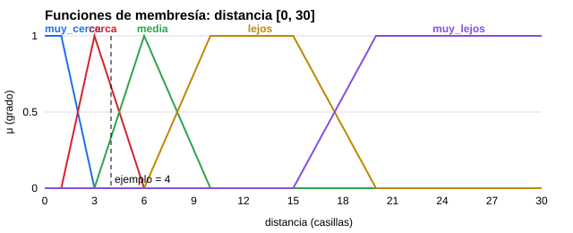
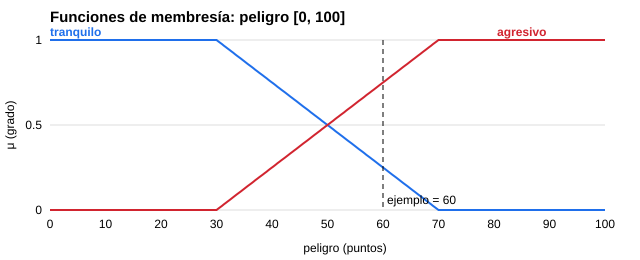
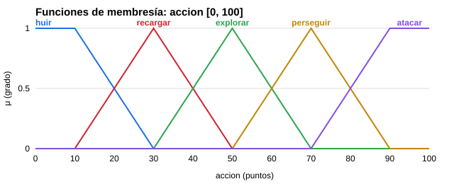
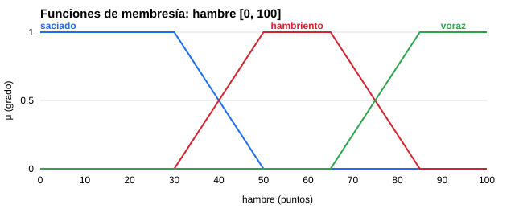
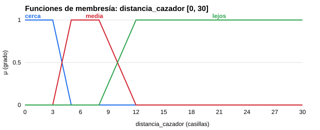
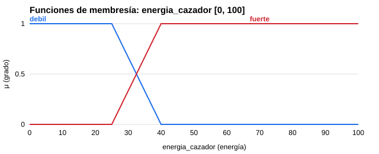
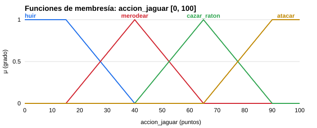
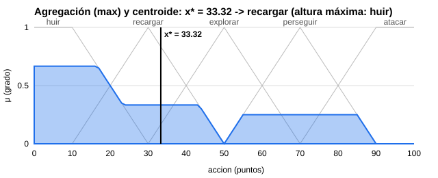

# Reporte del proyecto: agentes inteligentes en la selva

Inteligencia Artificial · Unidad 4 · TecNM Campus La Laguna

Un cazador debe explorar la selva, encontrar al jaguar, cazarlo y volver a su cabaña sin quedarse sin energía. El jaguar intenta sobrevivir, come ratones y, si tiene hambre, ataca. Los dos deciden **qué hacer** con lógica difusa de Mamdani y deciden **cómo moverse** con algoritmos de búsqueda (algoritmo genético y A\*). Los ratones son el Agente Tonto: siguen reglas fijas y no aprenden.

---

## 1. El agente inteligente y la arquitectura

El proyecto sigue el diagrama de la maestra: **DIOS** es el orquestador y coordina tres agentes.

```
                         DIOS (Logica_Difusa/dios.py)
          ┌────────────────────┼────────────────────┐
     AGENTE 1               AGENTE 2             AGENTE TONTO
     Cazador                Jaguar               Ratones
  lógica difusa          lógica difusa          reglas fijas
  + AG / A*              + A* / escape
```

| Agente | Qué percibe | Qué decide (lógica difusa) | Cómo se mueve |
| --- | --- | --- | --- |
| Cazador (Agente 1) | 5 sentidos y su memoria | huir, recargar, explorar, perseguir, atacar | Algoritmo genético de movimiento o A\* |
| Jaguar (Agente 2) | Distancia y energía del cazador, su hambre | huir, merodear, cazar ratón, atacar | A\*, escape inteligente o merodeo |
| Ratones (Agente Tonto) | Si el jaguar está a 3 casillas o menos | No usa lógica difusa | Huye en línea recta o camina al azar |

La **memoria** de cada agente difuso es su **base de conocimiento**: un archivo JSON con sus reglas (`Logica_Difusa/bases/cazador_equipo.json` y `jaguar_equipo.json`). DIOS carga cada base y le da a cada agente su controlador difuso.

**Ciclo de cada turno del cazador:**

```
Percibir (sentidos) → Recordar (memoria) → Decidir QUÉ hacer (lógica difusa)
   → Elegir meta → Decidir CÓMO llegar (AG o A*) → Moverse (física)
   → Premio o castigo → Anotar en la bitácora (autoconciencia)
```

El mundo es una cuadrícula de 11 × 20 casillas, generada al azar, con pasto, árboles (no se pueden cruzar), arena movediza (cuesta más avanzar), bayas rojas y azules, la cabaña del cazador, el jaguar y 6 ratones.

---

## 2. Percepción: los 5 sentidos del cazador

El cazador no ve todo el mapa: solo sabe lo que perciben sus sentidos (`Agente_Cazador/sentidos.py`).

| Sentido | Alcance | Qué detecta |
| --- | --- | --- |
| Vista | 4 casillas; los árboles la tapan | Al jaguar y el terreno (árboles, arena, bayas por su color) |
| Oído | 2 casillas; el sonido pasa entre los árboles | Al jaguar y su dirección aproximada |
| Olfato | 1 casilla | Al jaguar y bayas cercanas |
| Tacto | Su casilla y las vecinas | Arena movediza |
| Gusto | La baya que come | Si una baya es buena o mala (solo al probarla) |

Con la vista solo distingue el **color** de las bayas. Aprende si un color es bueno o malo al probarlo con el gusto, y desde ese momento lo recuerda.

---

## 3. Memoria

**Cazador** (`Agente_Cazador/memoria.py`):

- Casillas que ya observó y terreno que conoce.
- Última posición donde vio al jaguar y la anterior (para saber hacia dónde se mueve).
- Casillas que ha pisado y cuántas veces (para no dar vueltas).
- Bayas que ha visto (posición y color) y lo que aprendió de cada color.
- Metas que descartó porque no pudo llegar (se reconsideran después de unos turnos).

**Jaguar** (`Agente_Jaguar/memoria.py`): sus últimas posiciones (para no repetir movimientos), dónde vio bayas y dónde hay arena movediza.

---

## 4. Lógica difusa

La lógica difusa deja que algo sea "un poco" verdadero, con un grado de membresía entre 0 y 1. Así, el jaguar puede estar "cerca" en 0.67 y "a media distancia" en 0.33 al mismo tiempo, y el agente cambia de decisión poco a poco y no de golpe.

### 4.1 Variables lingüísticas

**Cazador (Agente 1)**

| Variable | Rango | Qué significa | Términos |
| --- | --- | --- | --- |
| reserva (entrada) | 0 a 100 | Energía que le sobra después de guardar la necesaria para volver a la cabaña | muy_baja, baja, media, alta |
| distancia (entrada) | 0 a 30 casillas | Distancia al jaguar, o a donde lo vio por última vez; 30 si no sabe nada de él | muy_cerca, cerca, media, lejos, muy_lejos |
| peligro (entrada) | 0 a 100 | Qué tan amenazante es el jaguar (ver 4.3) | tranquilo, agresivo |
| acción (salida) | 0 a 100 | Lo que va a hacer | huir, recargar, explorar, perseguir, atacar |

**Jaguar (Agente 2)**

| Variable | Rango | Qué significa | Términos |
| --- | --- | --- | --- |
| hambre (entrada) | 0 a 100 | Sube cada turno; baja al comer un ratón o una baya | saciado, hambriento, voraz |
| distancia_cazador (entrada) | 0 a 30 casillas | Distancia al cazador | cerca, media, lejos |
| energia_cazador (entrada) | 0 a 100 | Si el cazador está débil, el jaguar se anima a atacar | debil, fuerte |
| accion_jaguar (salida) | 0 a 100 | Lo que va a hacer | huir, merodear, cazar_raton, atacar |

### 4.2 Funciones de membresía

Usamos las cuatro funciones vistas en clase. Cada una se eligió según cómo se comporta la palabra:

| Función | Cuándo se usa | Ejemplo |
| --- | --- | --- |
| Triangular (X0, X1, X2) | La palabra tiene un punto ideal | distancia "cerca" = (1, 3, 6): es más cerca justo en 3 |
| Trapezoidal (X0 a X3) | La palabra es verdadera en todo un rango | reserva "baja" = (8, 18, 25, 35): de 18 a 25 es igual de baja |
| Grado (X0, X1) | La palabra está en la orilla derecha y sigue para siempre | distancia "muy_lejos" = (15, 20) |
| Grado inversa (X0, X1) | La palabra está en la orilla izquierda | reserva "muy_baja" = (8, 18) |

| Variable | Término | Función | X0 | X1 | X2 | X3 |
| --- | --- | --- | --- | --- | --- | --- |
| reserva | muy_baja | grado inversa | 8 | 18 | – | – |
| reserva | baja | trapezoidal | 8 | 18 | 25 | 35 |
| reserva | media | trapezoidal | 25 | 35 | 50 | 65 |
| reserva | alta | grado | 50 | 65 | – | – |
| distancia | muy_cerca | grado inversa | 1 | 3 | – | – |
| distancia | cerca | triangular | 1 | 3 | 6 | – |
| distancia | media | triangular | 3 | 6 | 10 | – |
| distancia | lejos | trapezoidal | 6 | 10 | 15 | 20 |
| distancia | muy_lejos | grado | 15 | 20 | – | – |
| peligro | tranquilo | grado inversa | 30 | 70 | – | – |
| peligro | agresivo | grado | 30 | 70 | – | – |
| acción | huir | grado inversa | 10 | 30 | – | – |
| acción | recargar | triangular | 10 | 30 | 50 | – |
| acción | explorar | triangular | 30 | 50 | 70 | – |
| acción | perseguir | triangular | 50 | 70 | 90 | – |
| acción | atacar | grado | 70 | 90 | – | – |
| hambre | saciado | grado inversa | 30 | 50 | – | – |
| hambre | hambriento | trapezoidal | 30 | 50 | 65 | 85 |
| hambre | voraz | grado | 65 | 85 | – | – |
| distancia_cazador | cerca | grado inversa | 3 | 5 | – | – |
| distancia_cazador | media | trapezoidal | 3 | 5 | 8 | 12 |
| distancia_cazador | lejos | grado | 8 | 12 | – | – |
| energia_cazador | debil | grado inversa | 25 | 40 | – | – |
| energia_cazador | fuerte | grado | 25 | 40 | – | – |
| accion_jaguar | huir | grado inversa | 15 | 40 | – | – |
| accion_jaguar | merodear | triangular | 15 | 40 | 65 | – |
| accion_jaguar | cazar_raton | triangular | 40 | 65 | 90 | – |
| accion_jaguar | atacar | grado | 65 | 90 | – | – |

**Cómo leer las gráficas:** el eje X (abajo) es el valor que mide el agente y el eje Y (izquierda) es el grado de membresía, de 0 a 1. Cada línea de color es un término. La línea punteada marca el valor del ejemplo de la sección 6. Las gráficas se generan solas a partir de `variables.py` con `python3 -m Logica_Difusa.graficas`.










### 4.3 Cómo calcula el cazador el peligro

El peligro no se mide directo: el cazador lo calcula con lo que percibe (`calcular_peligro` en `Agente_Cazador/agente.py`):

```
peligro = 0.40 × hambre del jaguar  +  máx(0, 40 − 4 × distancia)  +  30 si el jaguar lo está atacando
```

Si deja de percibir al jaguar, recuerda el último peligro y lo va olvidando en 6 turnos. Si nunca lo ha percibido, el peligro es 0. Siempre queda entre 0 y 100.

---

## 5. Reglas IF–THEN (base de conocimiento)

Las reglas son del tipo **SI antecedente ENTONCES consecuente**, sin ELSE. Si la condición no se cumple, la regla pesa 0 y no aporta nada; el caso contrario lo cubre otra regla con NO. Usan **Y** (AND = mínimo), **O** (OR = máximo) y **NO** (NOT = 1 − valor).

### 5.1 Cazador: 23 reglas

**R01 a R20**, matriz reserva (4) × distancia (5), cuando el jaguar NO es agresivo. Cada casilla es una regla: "SI reserva es … Y distancia es … Y NO peligro es agresivo ENTONCES …".

| reserva \ distancia | muy_cerca | cerca | media | lejos | muy_lejos |
| --- | --- | --- | --- | --- | --- |
| muy_baja | R01 recargar | R02 recargar | R03 recargar | R04 recargar | R05 recargar |
| baja | R06 atacar | R07 perseguir | R08 recargar | R09 recargar | R10 recargar |
| media | R11 atacar | R12 perseguir | R13 perseguir | R14 explorar | R15 explorar |
| alta | R16 atacar | R17 atacar | R18 perseguir | R19 perseguir | R20 explorar |

**R21 a R23**, cuando el jaguar SÍ es agresivo:

- R21: SI peligro es agresivo Y (distancia es muy_cerca O cerca) ENTONCES **huir**
- R22: SI peligro es agresivo Y distancia es media ENTONCES **recargar**
- R23: SI peligro es agresivo Y (distancia es lejos O muy_lejos) ENTONCES **explorar**

### 5.2 Jaguar: 11 reglas

**R01 a R09**, matriz hambre (3) × distancia al cazador (3), cuando el cazador NO está débil:

| hambre \ distancia_cazador | cerca | media | lejos |
| --- | --- | --- | --- |
| saciado | R01 huir | R02 merodear | R03 merodear |
| hambriento | R04 huir | R05 cazar_raton | R06 cazar_raton |
| voraz | R07 atacar | R08 atacar | R09 cazar_raton |

**R10 y R11**, cuando el cazador SÍ está débil:

- R10: SI energía del cazador es débil Y (distancia es cerca O media) ENTONCES **atacar**
- R11: SI energía del cazador es débil Y distancia es lejos ENTONCES **merodear**

### 5.3 Ratones: 2 reglas fijas (sin lógica difusa)

1. Si el jaguar está a 3 casillas o menos, huye en línea recta.
2. Si no, camina al azar y cambia de dirección cada 0.8 a 2 segundos.

---

## 6. Método de Mamdani paso a paso

Ejemplo: el cazador tiene **reserva = 30**, el jaguar está a **4 casillas** y el **peligro es 60**.

**Paso 1. Fuzzificación**

| Entrada | Grados |
| --- | --- |
| reserva 30 | baja = 0.5, media = 0.5 |
| distancia 4 | cerca = 0.67, media = 0.33 |
| peligro 60 | tranquilo = 0.25, agresivo = 0.75 → NO agresivo = 0.25 |

**Paso 2. Evaluar el antecedente de cada regla** (solo 6 de 23 tienen fuerza mayor a 0)

| Regla | Condición | Cálculo | Fuerza | Acción |
| --- | --- | --- | --- | --- |
| R07 | baja Y cerca Y NO agresivo | min(0.5, 0.67, 0.25) | 0.25 | perseguir |
| R08 | baja Y media Y NO agresivo | min(0.5, 0.33, 0.25) | 0.25 | recargar |
| R12 | media Y cerca Y NO agresivo | min(0.5, 0.67, 0.25) | 0.25 | perseguir |
| R13 | media Y media Y NO agresivo | min(0.5, 0.33, 0.25) | 0.25 | perseguir |
| R21 | agresivo Y (muy_cerca O cerca) | min(0.75, max(0, 0.67)) | 0.67 | huir |
| R22 | agresivo Y media | min(0.75, 0.33) | 0.33 | recargar |

**Paso 3. Implicación (min):** cada acción se recorta a la fuerza de su regla más fuerte: huir a 0.67, recargar a 0.33 y perseguir a 0.25.

**Paso 4. Agregación (max):** las acciones recortadas se juntan en una sola figura tomando el valor más alto en cada punto.

**Paso 5. Defuzzificación:** primero se calcula el centroide, x\* = 33.3 (sección 7). Luego se elige la acción según el método configurado:

| Método | Cómo elige | Resultado en el ejemplo |
| --- | --- | --- |
| Altura máxima (el que usa el juego por defecto) | La acción de la regla con más fuerza | R21 = 0.67 → **huir** |
| Centroide | La acción con más grado en x\* = 33.3 | recargar = 0.83 → **recargar** |



**Ejemplo del jaguar:** hambre 70, cazador a 4 casillas, energía del cazador 35. Se activan R04 huir (0.5), R05 cazar_raton (0.5), R07 y R08 atacar (0.25) y R10 atacar (0.33). El centroide da x\* = 48.1, que es **merodear**. Con altura máxima, huir y cazar_raton empatan en 0.5 y gana el primero en el orden de los términos: **huir**.

---

## 7. El centroide y el método de defuzzificación

La **defuzzificación** es el paso que convierte el resultado difuso (varias acciones con distinta fuerza) en una sola respuesta. El **centroide** es el método que usamos para hacerlo: es el punto de equilibrio de la figura agregada.

```latex
x^* = \frac{\sum x \cdot \mu(x)}{\sum \mu(x)}
```

Se calcula de forma numérica: el eje de 0 a 100 se divide en 101 puntos, de 1 en 1. En el ejemplo, Σ x·μ = 1043.05 y Σ μ = 31.30, así que x\* = 33.3.

**Cómo se mueve x\* con el peligro** (reserva 30, distancia 4):

| Peligro | x\* | Acción |
| --- | --- | --- |
| 0 a 30 | 53.0 | explorar |
| 40 | 47.8 | explorar |
| 50 | 42.2 | explorar |
| 60 | 33.3 | recargar |
| 70 o más | 19.1 | huir |

**Limitación del centroide:** promedia. Si dos acciones opuestas pesan lo mismo (por ejemplo huir y atacar), el centro cae en medio y sale una acción intermedia (explorar) que ninguna regla pidió. En las pruebas se ve un caso real: el jaguar voraz y cerca tiene "atacar" como regla más fuerte (0.70), pero el centroide da 61.2 y sale "cazar ratón".

**Otro método: altura máxima.** Elige la acción de la regla con más fuerza. Evita las acciones intermedias, pero ignora a las reglas más débiles. El código permite cambiar de método con una línea en `Logica_Difusa/motor_mamdani.py`:

```python
METODO_DEFUZZIFICACION = "altura_maxima"   # o "centroide"
```

**El juego usa altura máxima por defecto**, porque con nuestras reglas el cazador caza al jaguar casi 4 veces más que con el centroide (sección 15). El centroide se sigue calculando en cada decisión: aparece como x\* en el panel, en la bitácora y en la gráfica, y basta cambiar esa línea para que sea el centroide el que decida.

---

## 8. Algoritmo genético de movimiento (cazador)

La lógica difusa decide **qué** hacer y elige una meta (por ejemplo, el punto donde cortarle el paso al jaguar). El algoritmo genético decide **cómo** llegar (`Algoritmos/genetico.py`):

| Elemento | Valor |
| --- | --- |
| Cromosoma | 10 movimientos seguidos (arriba, abajo, izquierda, derecha) |
| Población | 20 cromosomas |
| Generaciones | Hasta 25 |
| Selección | Elitismo (los 2 mejores pasan directo); 4 padres |
| Cruce | De un punto, 70 % de las veces |
| Mutación | 10 % por gen |
| Aptitud | 1 / (distancia a la meta + 1) − 0.2 por choque − 0.3 por arena − 0.25 por casilla repetida |

Cada turno se ejecuta **solo el primer movimiento** del mejor cromosoma; en el siguiente turno se vuelve a calcular porque el mundo cambia. Si el algoritmo genético propone chocar, el cazador pierde 2 de batería; si da un buen paso, gana 1.

---

## 9. A\*, persecución y huida

**A\*** (`Algoritmos/a_Estrella.py`) busca el camino más barato con la distancia Manhattan como heurística. Costos por casilla: pasto 2, arena 8, baya mala conocida 20 y +2 si ya la pisó. Lo usan el cazador (cuando el algoritmo genético no es necesario o para planear) y el jaguar (para atacar o ir por un ratón).

**Persecución** (`Algoritmos/persecucion.py`): con las dos últimas posiciones del jaguar calcula hacia dónde se mueve y apunta hasta 2 casillas adelante, para interceptarlo y no llegar tarde.

**Huida** (`Algoritmos/huida.py` y `elegir_escape_inteligente` del jaguar): revisa las casillas vecinas y elige la que más lo aleja del perseguidor, evitando arena y callejones sin salida.

---

## 10. Física

Cada personaje tiene un cuerpo con masa (`Fisica/cinematica.py`). Para pasar de una casilla a otra acelera, alcanza una velocidad y recorre la distancia:

```
F_neta = F_motriz − μ·m·g − b·v      a = F_neta / m      v_max = (F_motriz − μ·m·g) / b
```

| Cuerpo | Masa | Fuerza motriz | Arrastre b |
| --- | --- | --- | --- |
| Cazador | 75 kg | 400 N | 120 N·s/m |
| Jaguar | 55 kg | 330 N | 120 N·s/m |

El rozamiento es 0.10 en pasto y 0.40 en arena, así que en arena todos van más lento. Al cambiar de dirección se pierde la mitad de la velocidad.

---

## 11. Autoconciencia

Los dos agentes difusos saben qué hicieron y por qué:

- **Bitácora del cazador:** en cada turno anota posición, meta, motivo, sentido usado, motor de movimiento (AG, A\*), resultado, energía, premio o castigo y la decisión difusa.
- **Bitácora del jaguar:** en cada turno anota sus entradas, la regla más fuerte, la acción, el centroide, el movimiento y su motor (A\*, escape, merodeo).
- **Tecla B:** imprime en la terminal la autoconciencia de los dos. Ejemplo del jaguar, con el método de centroide (con altura máxima la decisión habría sido ATACAR, por R07 = 0.70):

```
Entradas:
   hambre            = 79
   distancia_cazador = 2
   energia_cazador   = 88
Regla dominante: R07 -> atacar (0.70)
Centroide: x* = 61.2
Decisión: CAZAR_RATON
```

- **Panel en pantalla:** para cada agente muestra la decisión difusa con su regla más fuerte y su centroide, y el movimiento con el motor que lo calculó. Por ejemplo, `Difuso: ATACAR (R17 0.67, x*=81)` y `Movimiento: ABAJO | Motor: AG`. Así se ve la arquitectura en vivo: la lógica difusa decide y el algoritmo de movimiento ejecuta.

---

## 12. El jaguar

Cada turno su hambre sube 2 puntos. Comer un ratón la baja 50 y comer una baya la baja 35. Consulta sus 11 reglas con su hambre, la distancia al cazador y la energía del cazador:

| Acción difusa | Qué hace |
| --- | --- |
| atacar | Calcula dónde interceptar al cazador y va con A\* |
| huir | Escape inteligente; si está acorralado y el cazador está a 2 casillas o menos, contraataca |
| cazar_raton | Va con A\* al ratón más cercano que huela (6 casillas o menos); si no hay, camina buscando |
| merodear | Descansa o camina por la selva sin repetir casillas |

Después de atacar se retira 6 turnos sin consultar sus reglas. Si el jaguar llega a la casilla del cazador mientras ataca, el cazador pierde su vida; si no está atacando, el cazador lo atrapa.

---

## 13. Ratones (Agente Tonto)

Son agentes continuos (se mueven en el plano, no por casillas), sin memoria ni aprendizaje, con las 2 reglas fijas de la sección 5.3. Sirven de comida para el jaguar y de comparación: muestran la diferencia entre un agente que razona con reglas difusas y uno que solo reacciona.

---

## 14. Pruebas automáticas

`pruebas/test_logica_difusa.py` tiene 23 pruebas que comprueban cada parte del sistema difuso. Se corren con:

```bash
python3 -m unittest discover pruebas -v
```

| Grupo | Qué comprueba |
| --- | --- |
| Membresía | Los ejemplos de clase (adulto: 12 → 0, 19 → 0.333, 35 → 1), las 4 funciones y que todo grado queda entre 0 y 1 |
| Operadores | AND(0.8, 0.6) = 0.6 como en clase, OR, NOT, implicación y agregación |
| Base de conocimiento | 23 reglas del cazador, 11 del jaguar, guardar y cargar el JSON |
| Motor | El ejemplo de la sección 6 con los dos métodos: x\* = 33.32; centroide → recargar y altura máxima → huir (R21) |
| Cazador | reserva muy baja + tranquilo → recargar · reserva alta + jaguar muy cerca → atacar · agresivo + cerca → huir · reserva alta + media distancia → perseguir · reserva media + lejos → explorar |
| Jaguar | saciado + cerca → huir · voraz + cerca → atacar · hambriento + media → cazar ratón · saciado + lejos → merodear · cazador débil + cerca → atacar |
| Agentes | La bitácora del jaguar se llena y los escenarios de demostración empiezan como deben |

Resultado: **23 de 23 pruebas pasan.**

---

## 15. Resultados

Probamos el juego completo en 60 mapas que no se usaron para ajustar nada (semillas 1000 a 1059), con el simulador sin ventana (`Logica_Difusa/simulador.py`), comparando los dos métodos de defuzzificación:

| Método | Jaguar cazado | Cazador atacado | Cazador sin energía | Turnos promedio | Ratones comidos |
| --- | --- | --- | --- | --- | --- |
| Centroide | 15 % | 68 % | 15 % | 108 | 2.2 |
| **Altura máxima (por defecto)** | **55 %** | **43 %** | 2 % | 67 | 1.0 |

**Qué se ve:**

- El sistema difuso sigue el método de Mamdani: AND = min, OR = max, NOT = 1 − x, implicación min y agregación max, y calcula el centroide en cada decisión.
- Con este diseño de reglas y de comportamiento, el método de **altura máxima** caza al jaguar casi 4 veces más. La razón es la limitación del centroide (sección 7): cuando "perseguir" y "huir" pesan parecido, el centroide da "explorar" o "recargar", y el cazador duda en vez de terminar la caza. Por eso es el método por defecto.
- El jaguar es un rival difícil: con el centroide gana en la mayoría de los mapas, sobre todo porque su hambre sube rápido y se vuelve voraz.

---

## 16. Escenarios de demostración

Para la exposición, las teclas 1 y 2 cargan siempre el mismo mapa (`Mundo/escenarios.py`):

| Tecla | Escenario | Qué se ve | Qué tan seguido sale |
| --- | --- | --- | --- |
| 1 | Demo caza | explorar → detectar → perseguir → atacar → cazar → regresar a la cabaña | 29 de 30 partidas; si falla, se presiona 1 otra vez |
| 2 | Demo peligro | jaguar hambriento (85) a 3 casillas: el cazador empieza huyendo o recargando | 30 de 30 partidas |
| R | Mapa al azar | Juego normal | — |

Los mapas se eligieron probando muchas semillas en el simulador, con el método de altura máxima, y quedándonos con las que mejor muestran cada comportamiento. Con el centroide, la demo de caza sale en 10 de 20 partidas.

---

## 17. Limitaciones y decisiones abiertas

- **Reglas generadas por algoritmo genético.** La indicación de la maestra pedía "generar reglas del entrenamiento de los algoritmos genéticos". El equipo decidió usar reglas diseñadas a mano y dejar el algoritmo genético solo para el movimiento. El código del entrenamiento de reglas está en el historial de git (commit `b38539c`) por si se necesita.
- **Centroide contra altura máxima.** La práctica pide defuzzificación por centroide. El juego decide por altura máxima porque da mejores resultados con nuestras reglas, pero el centroide se calcula y se muestra siempre, y se activa cambiando una línea (sección 7). Conviene confirmar con la maestra si así es aceptable.
- **El jaguar siempre sabe dónde está el cazador.** Sus entradas usan la distancia real, no una percepción con sentidos como la del cazador.
- **Una sola vida.** El cazador muere con un solo ataque, así que un contraataque del jaguar acorralado termina la partida.

---

## 18. Cómo correr el proyecto

```bash
python3 main.py
```

| Tecla | Qué hace |
| --- | --- |
| Espacio | Iniciar o pausar |
| R | Reiniciar con un mapa al azar |
| 1 / 2 | Escenarios de demostración |
| B | Autoconciencia del cazador y del jaguar en la terminal |
| Esc | Salir |

Otros comandos:

```bash
python3 -m unittest discover pruebas -v      # pruebas automáticas
python3 -m Logica_Difusa.graficas            # volver a dibujar las gráficas
```

Se necesita Python 3 con pygame instalado.
